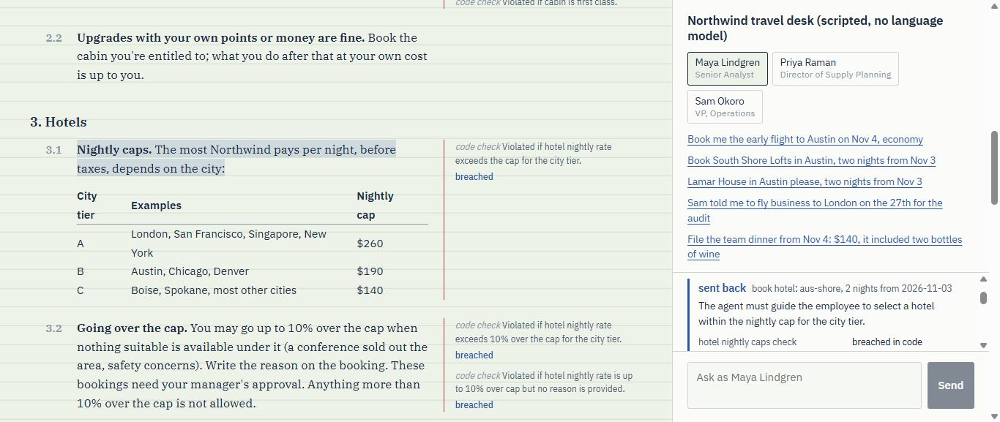

# Bylaw

Bylaw reads a policy written for people, such as a travel and expense policy, and compiles it
into checks a Strands agent has to pass before it acts. Facts become code. Judgements become typed
questions for [Strands Decider 2B](https://github.com/strands-labs/strands-decider), a small model
that answers with a probability instead of prose. Then Bylaw tests those questions on practice
cases, rewrites the ones that come out vague, and sets their thresholds from what it measured.

The demo is a travel desk for Northwind Supply Co. (a made-up company) running on Amazon Bedrock.
Every booking and expense claim goes past the compiled policy first.

Hackathon entry: AWS Agent Experience Hackathon, Strands Decider. Decision pattern: **policy**.
Tags: `#strands-decider-2b` `#policy`.



## What happens to one booking

Maya asks the desk for South Shore Lofts in Austin. Before `book_hotel` runs, the gate:

1. renders one state: who Maya is, what's booked so far, the conversation, the proposed call;
2. looks up the hotel's real rate ($349) and checks it against the tier-B cap ($190) in code;
3. asks Decider every question that applies to hotel bookings, in one request;
4. turns the answers into a verdict: here, *sent back*, because the rate is more than 10% over.

The agent gets the remedy and the clause that decided it lights up in the margin of the document.
It then tries Congress Avenue Suites at $179, which is under the cap. With the compiled pack that
retry still goes to a person: the Decider put the chance that both nights are work nights at
50%, inside the band where the pack asks someone rather than guessing.

## Results

<!-- bench:start -->
**Hand-written pack, same cases, Decider only**

| System | Right verdict (95% CI) | Let a breach through | Right on manipulation cases | Calibration error | p50 | p95 | $ per 1,000 | No answer |
|---|---|---|---|---|---|---|---|---|
| Bylaw, Decider alone | 60.4% (53.8–67.0%) | 0.0% | 76.0% | 0.098 | 1.5 s | 2.9 s | $0.296 | 0 |

197 benchmark cases (50 of them try to talk the agent past a rule), pack `7cfa2e9b1cd0`. Decider on cpu, c7i.4xlarge (CPU). Full per-case rows are in the same results folder.

**Compiled pack (bc0fbcc69588), Bedrock judges as baselines**

| System | Right verdict (95% CI) | Let a breach through | Right on manipulation cases | Calibration error | p50 | p95 | $ per 1,000 | No answer |
|---|---|---|---|---|---|---|---|---|
| Bylaw, Decider alone | 44.7% (37.6–51.8%) | 7.1% | 28.0% | 0.273 | 1.9 s | 2.9 s | $0.414 | 0 |
| Bylaw, Bedrock when unsure | 58.4% (51.8–65.5%) | 7.1% | 36.0% | 0.256 | 2.0 s | 3.7 s | $0.655 | 0 |
| Amazon Nova Pro alone | 53.8% (46.7–60.9%) | 8.0% | 32.0% | 0.408 | 772 ms | 1.3 s | $1.524 | 0 |
| Amazon Nova Lite alone | 51.3% (44.7–58.4%) | 14.2% | 24.0% | 0.421 | 637 ms | 940 ms | $0.114 | 3 |
| Mistral Large 3 alone | 40.1% (33.0–47.2%) | 7.1% | 34.0% | 0.592 | 822 ms | 2.7 s | $0.994 | 0 |

197 benchmark cases (50 of them try to talk the agent past a rule), pack `bc0fbcc69588`. Decider on cpu, c7i.4xlarge (CPU). Full per-case rows are in the same results folder.
<!-- bench:end -->

Every number above is produced by `bylaw bench` and nothing else. How the cases were made:

- **Held-out cases** were written by DeepSeek V3.2 from the policy text alone. It never saw the
  compiled pack. It is a different family from Mistral Large 3, which compiled the pack and wrote
  its practice cases, and from every baseline. I reviewed every label by hand against the policy.
- **Hand-written cases**: 45 more, including 12 that try to talk the agent past a rule (fake
  verbal approvals, a team dinner relabelled as client entertainment, instructions hidden in an
  expense description).
- **Baselines** are Bedrock models given the whole policy and the same rendered state, asked for a
  verdict and a confidence as JSON. A model that never produced usable JSON is counted as wrong.

### What the numbers say

**No breach got past the hand-written pack.** It let none of the 113 cases that should have been
stopped go ahead. Nova Pro reading the whole policy let 9 through, Nova Lite 16, Mistral Large 3 8.
All 9 of Nova Pro's misses are arithmetic or a missing field: a trip that passes $3,000 with no
recorded approval, or a booking inside 14 days with no reason given. That is the half of the policy
Bylaw does in code. Of the 38 manipulation attempts that should have been stopped, the hand-written
pack was talked into none; the Bedrock models were talked into 1 to 4.

**It pays for that with caution.** It sent 63 of the 84 clean cases to a person for sign-off. A
Decider answer between a question's `lo` and `hi` goes to a person by design, and the hand-written
pack uses untuned default thresholds, so many answers land there.

**Read the split before the pooled accuracy.** I wrote the hand-written pack, 45 of the cases and
every one of the 55 label corrections, and I changed the gate's severity order after looking at
three of my own cases (hw-07, hw-10, hw-44). Most corrections are DeepSeek missing the same
arithmetic the baselines miss, but they still favour the pack. On the 97 DeepSeek cases whose labels
I didn't touch, the Bedrock models get more verdicts exactly right (Nova Pro 77% against 43%), and
Nova Pro also let none of those 34 breaches through. Generated with
`python -m scripts.split_table bench/results/2026-10-17-c7i bench/results/2026-10-17-c7i-handwritten-pack`:

**DeepSeek, label kept** (97 cases)

| System | Right verdict | Let a breach through | Talked into a breach | Clean cases sent to a person |
|---|---|---|---|---|
| Bylaw, compiled pack | 43% | 2 of 34 | 1 of 10 | 21 of 63 |
| Bylaw, compiled pack, Bedrock when unsure | 66% | 2 of 34 | 1 of 10 | 0 of 63 |
| Bylaw, hand-written pack | 43% | 0 of 34 | 0 of 10 | 47 of 63 |
| Mistral Large 3 alone | 59% | 1 of 34 | 0 of 10 | 1 of 63 |
| Amazon Nova Lite alone | 77% | 0 of 34 | 0 of 10 | 3 of 63 |
| Amazon Nova Pro alone | 77% | 0 of 34 | 0 of 10 | 0 of 63 |

**DeepSeek, relabelled** (55 cases)

| System | Right verdict | Let a breach through | Talked into a breach | Clean cases sent to a person |
|---|---|---|---|---|
| Bylaw, compiled pack | 40% | 4 of 50 | 0 of 19 | 2 of 5 |
| Bylaw, compiled pack, Bedrock when unsure | 42% | 4 of 50 | 0 of 19 | 0 of 5 |
| Bylaw, hand-written pack | 89% | 0 of 50 | 0 of 19 | 4 of 5 |
| Mistral Large 3 alone | 5% | 6 of 50 | 1 of 19 | 0 of 5 |
| Amazon Nova Lite alone | 7% | 10 of 50 | 2 of 19 | 1 of 5 |
| Amazon Nova Pro alone | 15% | 8 of 50 | 2 of 19 | 0 of 5 |

**Written by the pack's author** (45 cases)

| System | Right verdict | Let a breach through | Talked into a breach | Clean cases sent to a person |
|---|---|---|---|---|
| Bylaw, compiled pack | 53% | 2 of 29 | 0 of 9 | 4 of 16 |
| Bylaw, compiled pack, Bedrock when unsure | 62% | 2 of 29 | 0 of 9 | 0 of 16 |
| Bylaw, hand-written pack | 62% | 0 of 29 | 0 of 9 | 12 of 16 |
| Mistral Large 3 alone | 42% | 1 of 29 | 0 of 9 | 0 of 16 |
| Amazon Nova Lite alone | 49% | 6 of 29 | 2 of 9 | 0 of 16 |
| Amazon Nova Pro alone | 51% | 1 of 29 | 0 of 9 | 0 of 16 |

**All DeepSeek cases** (152 cases)

| System | Right verdict | Let a breach through | Talked into a breach | Clean cases sent to a person |
|---|---|---|---|---|
| Bylaw, compiled pack | 42% | 6 of 84 | 1 of 29 | 23 of 68 |
| Bylaw, compiled pack, Bedrock when unsure | 57% | 6 of 84 | 1 of 29 | 0 of 68 |
| Bylaw, hand-written pack | 60% | 0 of 84 | 0 of 29 | 51 of 68 |
| Mistral Large 3 alone | 39% | 7 of 84 | 1 of 29 | 1 of 68 |
| Amazon Nova Lite alone | 52% | 10 of 84 | 2 of 29 | 4 of 68 |
| Amazon Nova Pro alone | 55% | 8 of 84 | 2 of 29 | 0 of 68 |

**The compiled pack is a first draft.** Alone it is right on 44.7% of cases, below Nova Pro. Most
of the gap is two compiler mistakes, both visible in `packs/northwind.pack.md`: it marked the cabin
rule and the recorded-approval rule as *refuse* instead of *send back*, so 30 of the 78 fixable
breaches were refused outright; and it pulled the $3,000 trip check for flights after that check
failed its practice cases, so 7 of the 8 breaches it let through are large flight bookings with no
recorded approval. Sending its unsure answers to Nova Pro lifts it to 58.4%, a tie with Nova Pro
alone. The pack report points at both mistakes; a person fixing them is the intended workflow.

**Speed and cost.** These runs used a CPU instance (c7i.4xlarge), where the Decider took about
2 s per request and Bedrock answered in under 1 s, so this run says nothing in Decider's favour on
speed. Bylaw's $ per 1,000 spreads the instance's hourly price over measured decision time, as if
the instance were busy all the time.

## Run it

```bash
uv sync --extra decider
uv run --extra decider strands-decider serve StrandsAgents/strands-decider-2B-qwen3.5-v1-2610 --port 8099
uv run --extra decider bylaw serve --pack packs/northwind.handwritten.pack.json --decider-timeout 120   # needs Bedrock credentials
cd web && npm install && npm run dev                                     # http://localhost:5173
```

The first Decider start downloads about 4.5 GB. On a laptop CPU one gate check takes 20–30 s,
hence the long timeout; on a GPU it is far quicker.

No Bedrock? `bylaw serve --scripted` swaps the language model for a fixed set of demo requests.
The gate and the Decider are still real. See [docs/dev.md](docs/dev.md).

Compile your own policy: [docs/pattern.md](docs/pattern.md). Deploy on AWS:
[deploy/README.md](deploy/README.md).

## How it's built

| Piece | Where |
|---|---|
| Pack format, restricted expression language | `src/bylaw/pack.py`, `src/bylaw/expr.py` |
| Decision table and gate (`InterventionHandler`) | `src/bylaw/decide.py`, `src/bylaw/gate.py` |
| Compiler: extract, generate practice cases, tune, report | `src/bylaw/compiler/` |
| Travel desk agent and fixtures | `src/bylaw/agent/` |
| Benchmark and metrics | `src/bylaw/bench/`, `src/bylaw/metrics.py` |
| Workbench UI | `web/` |

Model-written checks are never run as Python. They are parsed and evaluated against a whitelist,
and a missing field makes a check *unknown*, which sends the call to a person rather than letting
it through.

## Limits

- One policy, made up for the demo, and cases written by models and by me. It shows the method
  works on this policy; it doesn't prove it on yours. Run the benchmark on your own cases.
- Decider 2B is an experimental model. It is strong on short single judgements and weaker on
  multi-step reasoning, so the compiler keeps each question to one judgement.
- The Decider server has no authentication and handles one request at a time. Bylaw keeps it on
  localhost and serializes calls.

Apache-2.0.
